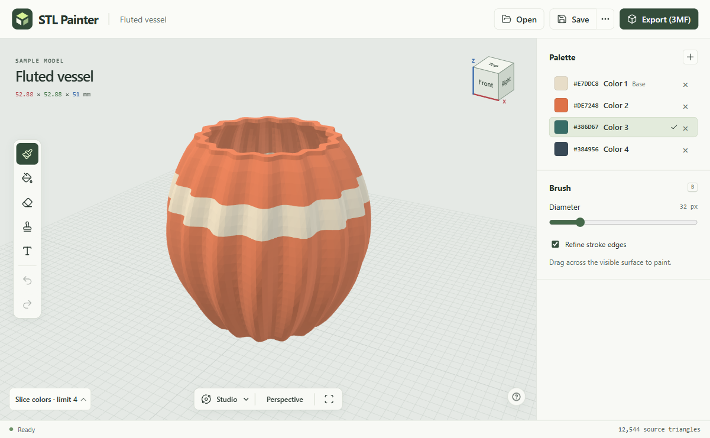
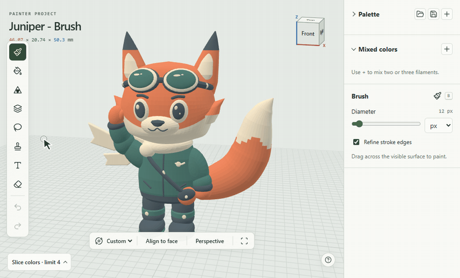
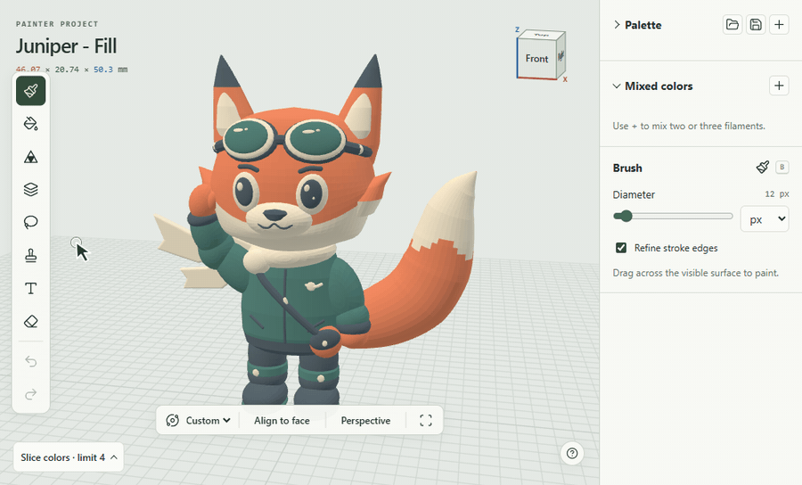
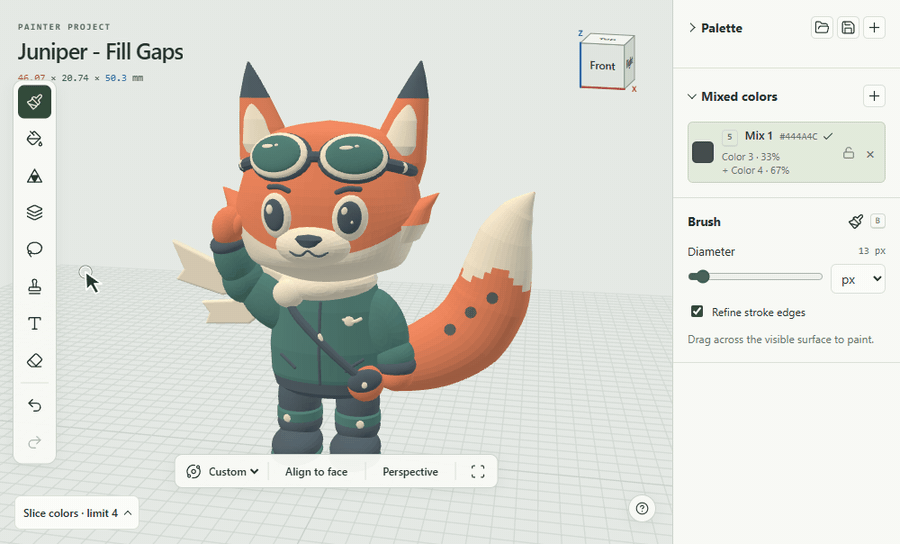
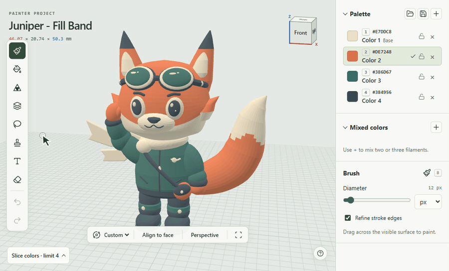
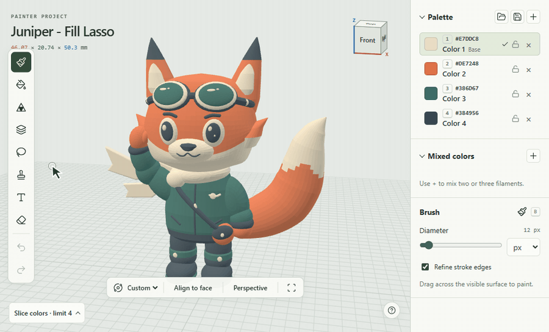
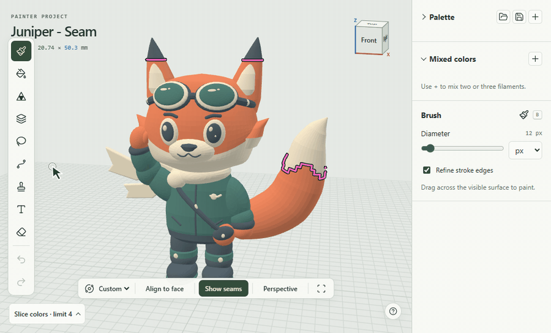
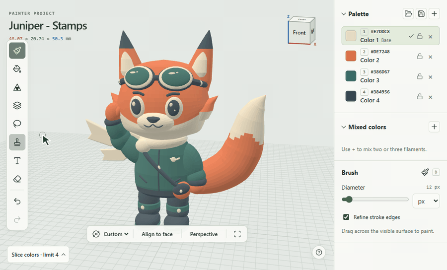
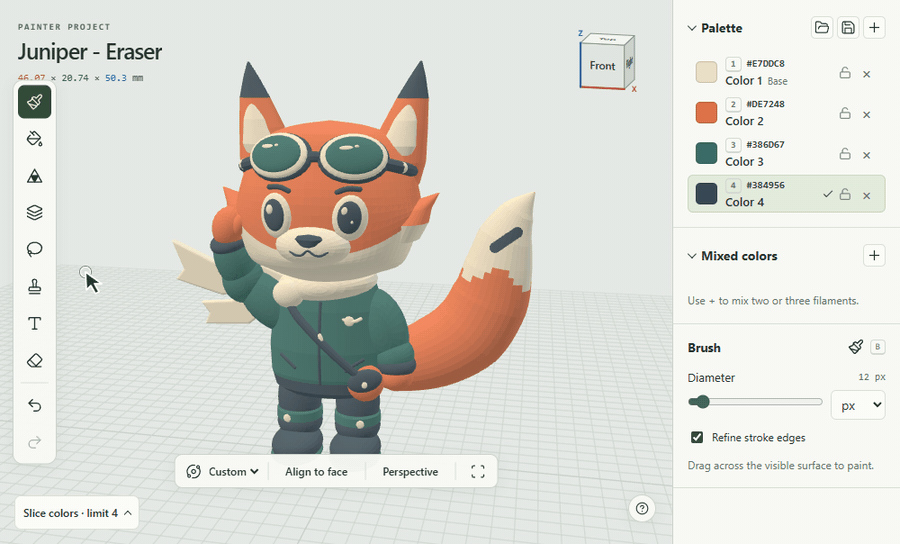

# STL Painter

STL Painter is an offline Windows desktop app for preparing multicolor 3D prints. Open an STL, paint the surface, add a logo or lettering, and export a color-painted 3MF for your slicer. Save a painter project if you want to come back and edit it later.

**[Download STL Painter 1.1.0 for Windows (64-bit portable ZIP)](https://github.com/secretsather/stl-painter/releases/download/v1.1.0/STL-Painter-1.1.0-Windows-x64.zip)**

[What's new in STL Painter](CHANGELOG.md)



## Install on Windows

Use **64-bit Windows** with graphics support for WebGL 2.

1. Download the Windows ZIP using the link above.
2. Right-click the ZIP and choose **Extract All**.
3. Open the extracted folder and double-click **STL Painter.exe**. Keep the executable with the accompanying files.

Keep your saved projects in a separate folder. To update a portable copy, extract the new ZIP into its own folder and open your existing projects from there.

## Paint your first model

1. **Open a model.** Try painting Juniper, the four-color fox aviator, or click **Open** and choose a binary or ASCII `.stl`. Juniper starts with closed seams around the tail tip and both ear tips. To try one, choose **Fill**, enable **Stop at seams**, and click inside the loop. The upper-left readout shows X, Y, and Z dimensions in millimeters.
2. **Choose a color.** Click a palette row to paint with that color. Click its colored square to change the color itself. **Color 1** is the base exposed by the eraser.
3. **Paint the surface.** Choose **Brush** and left-drag across the model. Right-drag on a detail to orbit around that spot, or start in empty space to keep the current pivot. Hold the mouse wheel and drag to pan, and scroll to zoom. Click a face of the view cube to work straight on.
4. **Save your work.** Click **Save** to write a self-contained `.stlp` with the model, paint, palette, and stamp library. Use **Ctrl+Shift+S** to save a separate copy.
5. **Export for printing.** Apply any pending stamp or text, then click **Export (3MF)**. Choose **Full color** to keep the original filament assignments, or **Limit to printer heads** to share slots and save a companion PDF. If you painted with mixed colors, open the 3MF as a project in a slicer that supports mixed filaments so the recipes load. Check the filament assignments before slicing.

## Painting tools

**Pick a color from the model.** Hold **Alt** and click a painted spot to select its exact solid color or saved mix. Your current tool stays active.

Click the **padlock** beside a solid color or saved mix to protect surfaces painted with that swatch. For example, lock gold trim and brush across its edge to paint the surrounding area. Fill stops at locked paint, and painting, erasing, stamps, lettering, and Fill Band skip it. Click the padlock again to unlock it. Locks are saved with the painter project.

Choose **Project → Clear all paint** in the header to reset unlocked paint to **Color 1**, including applied stamps and text. Your palette and stamp library stay available. Press **Ctrl+Z** to restore the previous paint in one step.

Choose **Project → Repair STL** to check the current model’s geometry. Review the findings and any warning about affected paint before choosing **Apply repair**. One **Undo** restores the original geometry and paint.

To paint straight onto an angled face, click **Align to face** in the camera toolbar, then click the polygon. The camera centers on that point and looks straight at the face. Your painting tool resumes immediately. Press **Esc** to cancel before selecting a face.

### Brush

Drag to paint the visible surface. Set **Diameter** in pixels or millimeters.

<details>
<summary>See Brush in action</summary>



</details>

### Fill

Hover over a face to see which area will change. Click to fill the highlighted region with the selected color. **Edge angle** controls how sharp an edge the fill can cross. **Respect paint boundaries** stops the fill at an existing color change.

<details>
<summary>See Fill in action</summary>



</details>

### Fill Gaps

Press **G** to preview pinholes. **Maximum gap size** defaults to **0.5 mm** and measures the widest span of a patch enclosed by one swatch.

Turn on **Include thin seams** to scan for narrow strips by their width. If the same swatch borders both sides, it fills the strip. If two different swatches enclose a strip of a third color, each seam triangle takes the nearer side’s color. This works with solids and saved mixes, including along jagged edges and pointed tips. Wider sections, locked paint, and open mesh edges are skipped. The preview shows where the colors will meet. Click **Apply** to commit the preview in one undoable edit, or press **Esc** to cancel.

<details>
<summary>See Fill Gaps in action</summary>



</details>

### Fill Band

Press **H** and choose **Bottom to top (Z)**, **Left to right (X)**, or **Front to back (Y)**. The default is Z. **From** and **To** are measured in millimeters from the model’s bottom, left, or front edge respectively. Click two bounds in either order or enter them directly. Click beyond an end of the model to include that edge. Orbit to inspect the preview, then choose **Apply band** to paint the unlocked surfaces within it. **Esc** cancels the preview.

<details>
<summary>See Fill Band in action</summary>



</details>

### Fill Lasso

Press **L** and position the view. Click on the model or background to place the first node and lock the camera. A smooth curve passes through each node. Move the pointer to preview the next arc, then click to place it. Backspace removes the last node. After placing at least three nodes, click the first node again to close the loop and preview the fill. **Refine stroke edges** follows the curve across coarse triangles. Click **Apply lasso** to paint the visible, unlocked area in one undoable edit, or press **Esc** to cancel. Either action releases the camera.

<details>
<summary>See Fill Lasso in action</summary>



</details>

### Seam

Press **M**, then hold the left mouse button on the model and move the node into position. The yellow line previews the path from the previous node as you move. Release on the surface to place it. A quick click also places a node. Releasing over empty space discards that placement. **Smooth seam** is on by default. The third node rounds the path through the middle node, like Fill Lasso. Turn it off for straight segments. Orbit, pan, zoom or use the view cube between placements. Changing the view fixes the path drawn so far on the model. Keep the previous node and the surface between placements in view. Drag a placed node to adjust the path.

To close a loop, guide it back to its first node and click that node. **Enter** or **Apply seam** splits the triangles along the displayed line and keeps open ends open. **Backspace** steps back and **Esc** cancels the draft.

In **Fill**, enable **Stop at seams** to preview and paint one side. Fill can travel around an open end. Switch to **Seam** to see the saved guides and the **Seams** list below the tool controls. **Show seams** toggles the saved guides while you work. Each row shows the seam’s name and whether it is open or closed. Click a row to edit or remove that seam, or click **+** to start a new one. To rename a seam, double-click its name (or focus its row and press **F2**). Type the new name and press **Enter** to save or **Esc** to cancel.

<details>
<summary>See Seam in action</summary>



</details>

### Stamps

Select **Import artwork** for a PNG, JPEG, WebP, or BMP. Choose existing palette colors or add colors from the image, then click **Add to stamps**. Adjust width and rotation, drag into position, and click **Apply stamp**.

<details>
<summary>See Stamps in action</summary>



</details>

### Text

Type a label, choose an installed font and palette color, and set size, bold, italic, or multiline alignment. Position it and click **Apply text**. The project stores applied lettering as surface paint.

<details>
<summary>See Text in action</summary>


</details>

### Eraser

Drag to restore the base color. Brush and Eraser share the **Refine stroke edges** setting.

<details>
<summary>See Eraser in action</summary>



</details>

## Brush and artwork settings

**Physical sizing.** Select **mm** beside Diameter, Font size, or Width and type a measurement. A 2 mm brush and an 8 mm stamp keep their size as you zoom. Brush and Eraser share a diameter. Stamp width includes transparent margins. Font size is the font’s em size, so the visible height depends on the letters and font. Measurements use one STL coordinate unit per millimeter and apply in the view plane at the surface under the cursor or artwork center. Face a flat surface straight on to reproduce a dimension along it. Select **px** for a fixed size on screen.

**Edge refinement** starts on. It subdivides the painted surface along a boundary to smooth strokes, stamp outlines, and lettering. When you finish a stroke or apply paint, subdivisions along the edited edge merge back together wherever both halves use the same swatch. One **Undo** restores the previous colors and subdivisions. Stamps and text use a quick preview while you drag and refine when you release. **Esc** cancels placement and returns to Brush.

**Stamp transparency.** In the import preview, scroll over a detail to zoom and drag to pan. Adjust **Opacity cutoff** to remove a faint halo or recover thin lines. **Show removed pixels** highlights what the cutoff excludes. The checkerboard marks areas where the model’s existing paint will show through. Select **Fit image** to see the whole stamp again.

**Reusing artwork.** When you return to Stamps, click an imported thumbnail to start a placement. The dotted outline shows its position, including over empty space in the viewport. Click **×** beside a stamp to remove it from the library. Copies already applied to the model keep their paint.

## Palette and printer color limits

Opening another STL in the same session carries over your current palette, mixed-color recipes, and selected swatch. The new model starts in the palette’s base color. Opening a saved painter project restores that project’s own palette and selection.

**Reuse a palette across projects.** Click **Save palette** (the disk beside the Palette heading) to save the base color, filaments, and mixed-color recipes to a `.stlpalette` file. In another project, click **Load palette** (the folder) and select that file. Base-colored areas use the new base. Painted areas and stamp pixels keep exact color matches wherever possible and otherwise use the closest available swatch. **Undo** restores the previous palette and color assignments in one step.

**Palette** holds physical filaments. **Mixed colors** below it holds recipes. Click either heading to collapse or expand its list. Click **+** beside Mixed colors and choose **Two filaments** or **Three filaments**. Pair suggestions use 50/50, 33/67, and 67/33. Each suggested trio has one swatch at 33/33/34. If you already saved that trio with the extra 1% on another filament, the picker shows your saved recipe. Larger palettes show a selection of up to 90 swatches. Select a swatch to preview the recipe and click **Add mix** to keep it. Each filament must contribute at least 33%.

Click a mix to paint with it or click its colored square to edit the recipe. Choose another suggested swatch or edit the percentages directly. Mixed swatches use an offline model calibrated on printed PLA. Layer height, surface angle, and the spools you load can affect the printed result. When reopening an older project, a mix keeps its original swatch if updating the preview would make it identical to another color. Its recipe and painted regions are preserved.

Image stamps match colors by perceptual distance in Oklab. For visually close matches, the importer favors an existing spool, then a saved mix. **Add mixed colors from existing filaments** suggests recipes that improve the image and adds them when you confirm. **Add Color** suggests a spool that fills a gap among the current solids and possible blends. You can edit the suggested color before painting.

The horizontal slice check counts the physical filaments in each painted recipe. A 3MF with mixed paint includes the physical palette in order, the used recipes, and their painted faces. Open it as a **project** in a slicer that supports mixed filaments to load both the geometry and the recipes.

A project can have **1–16 physical filament colors** and up to **255 total swatches** including mixes. Use **+** to add one or **×** to remove one. If the color is in use, choose a replacement for the model and saved stamps. Removing the base color lets you choose a new base. The last color stays in the palette. **Ctrl+Z** restores a removed color or stamp during the current editing session.

For a four-head printer, click **Slice colors** in the lower-left of the viewport and set **Colors per horizontal slice** to **4**. A fifth filament at the same height triggers a red warning triangle. Click it to see the colors involved and an example height.

The **Toolhead swap plan** shows which physical colors to load first, which share each head, and when to swap them. Pause windows are in millimeters above the model base. Swaps with a common window can be done together. If a color comes back higher on the model, the plan includes the return swap. When overlapping colors prevent a fixed head assignment, the panel reports it.

In **Export (3MF) → Limit to printer heads**, choose the available head count (initially the Slice colors limit, or four when it is off). Review the plan and choose a save location. The 3MF uses the starting spool color for each assigned head, including regions that change spool later. A file named `<model> - swap plan.pdf` beside the 3MF lists the original spool numbers, color swatches, and every swap. Full-color export remains available if a head limit cannot accommodate the paint.

Open the exported 3MF as a project in Snapmaker Orca. Each planned swap has a suggested pause marker at the midpoint of its window. Keep the same print orientation and map each slot to the corresponding printer head. Slice and compare the pause layers in **Preview** with the windows in the PDF. Check that the outgoing filament has finished and the incoming filament has yet to start, including supports and infill. If a marker falls on the wrong layer, adjust it and re-slice. A narrow window may require a finer layer height.

The limit defaults to four, accepts 1–16 or **Off**, and is remembered on this computer. The check uses committed surface paint, including the base color. Your slicer determines the final tool changes, infill, and supports.

## Controls

[Download the printable hotkey cheat sheet (PDF)](docs/STL-Painter-Hotkeys.pdf)

| Action | Control |
| --- | --- |
| Brush / Fill / Fill Gaps / Fill Band / Fill Lasso / Seam / Stamps / Text / Eraser | B / F / G / H / L / M / S / T / E |
| Pick a painted color or mix | Alt + left click |
| Select a swatch in sidebar order (solid colors first, then saved mixes) | **1–9** select the first nine. **0** selects the tenth. |
| Orbit / pan / zoom | Right-drag / middle-drag / scroll |
| Fit the model in the studio view | Home |
| Change brush or eraser diameter | [ and ] |
| Decrease / increase the Fill edge angle while previewing | Tap [ or ] for 1°. Hold to repeat after a short pause. |
| Apply a ready Fill Band, Fill Gaps, Fill Lasso, seam, stamp, or text preview | **Enter** or **numpad Enter**. In the text editor, Enter starts a new line. |
| Remove the last Fill Lasso node, including from a closed preview | Backspace |
| Cancel placement and return to Brush | Esc |
| Undo / redo | Ctrl+Z / Ctrl+Y or Ctrl+Shift+Z |
| Open / save / save as | Ctrl+O / Ctrl+S / Ctrl+Shift+S |

Click **Perspective** to switch to orthographic projection. Drag the left edge of the sidebar to resize it, or double-click the edge to restore its default width. The **?** button opens the in-app controls guide.

## Model and artwork limits

- STL Painter supports up to **1,500,000 source triangles** and warns before opening a model above **1,000,000**.
- Each project supports **2,000,000 paint triangles**, including the initial paint grid and subdivisions added while painting. The status bar shows the current total beside the source triangle count.
- A stamp image can be up to **32 MB** and **16 megapixels**. Palette mapping samples up to **512 pixels** along the longest side. Each project has a **96 MB** embedded artwork budget.
- Export preserves the usable source triangles and encodes the refined paint boundaries in the 3MF. Undo history lasts for the current editing session.

## Run from source

On Windows, install **Node.js 24** with npm. Download or clone this repository, open PowerShell in the folder containing `package.json`, and run the following commands. The first two install the locked dependencies and the Electron runtime.

```powershell
npm.cmd ci
npx.cmd install-electron
npm.cmd start
```

### Package for Windows

| Command | Result |
| --- | --- |
| `npm.cmd run dist:portable` | Builds the Windows x64 portable ZIP in `release/`. |
| `npm.cmd run dist` | Builds the Windows x64 installer in `release/`. |

The maintainers run the test suite locally before publishing a release.
